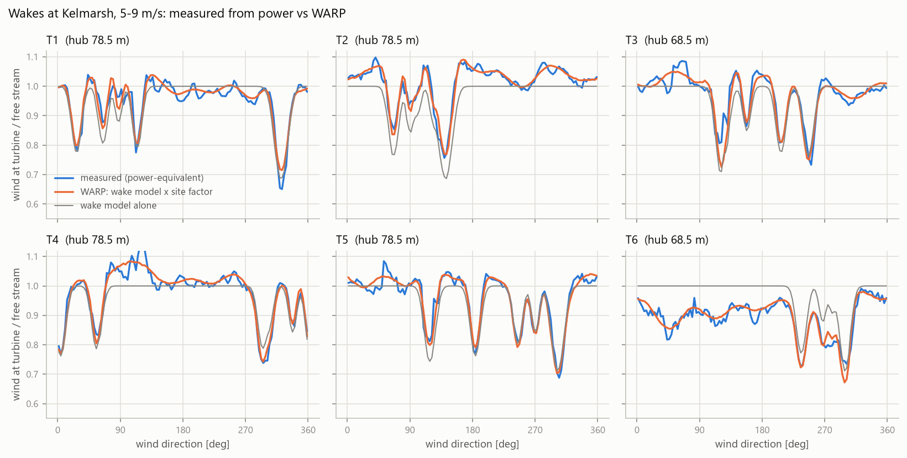
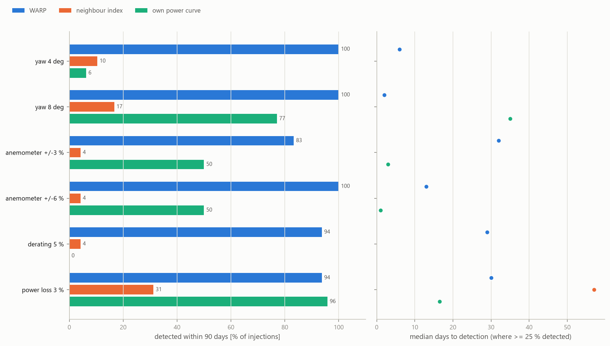
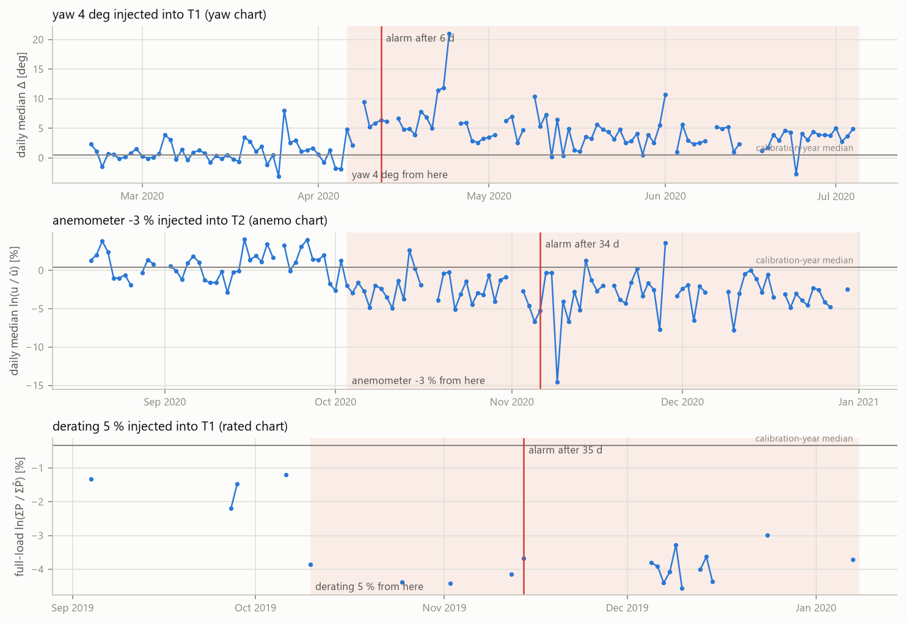
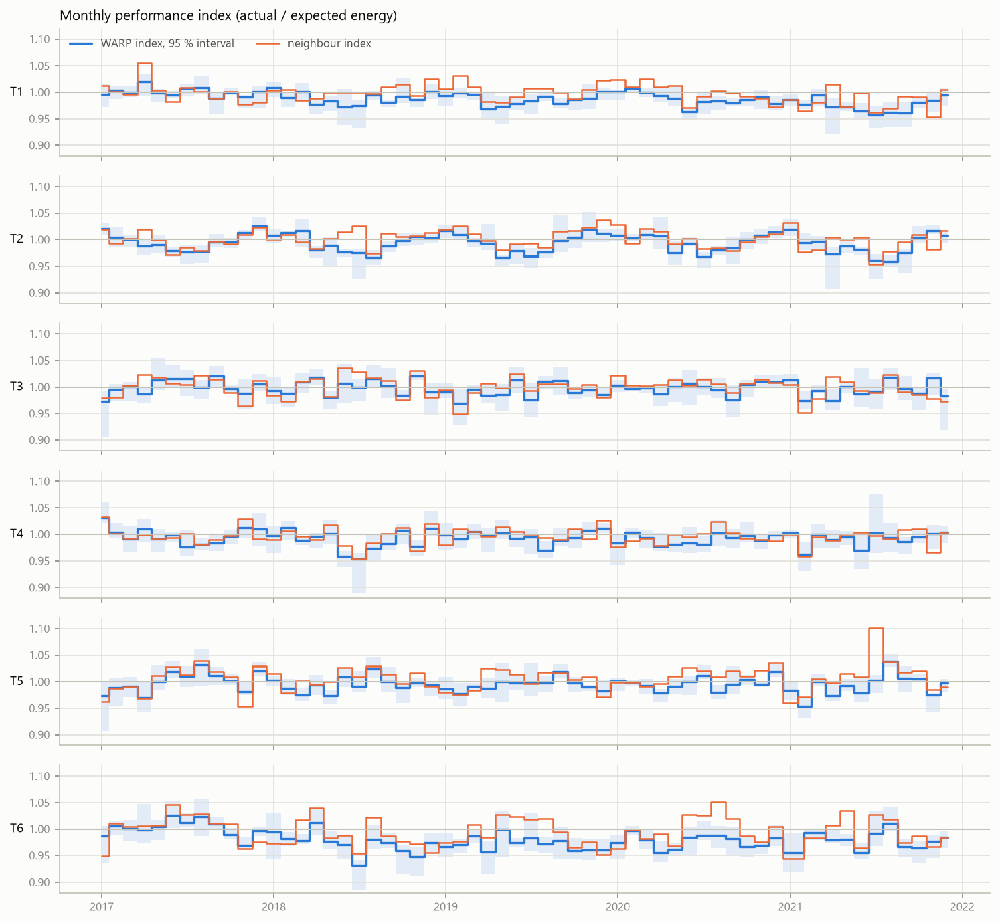
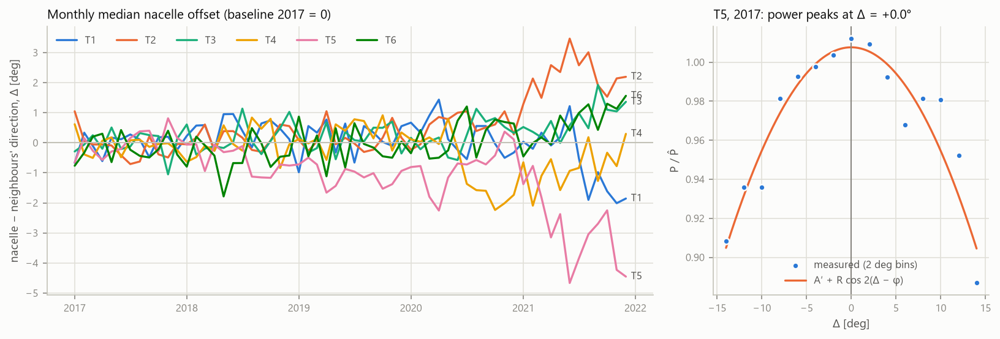

# Wake-aware performance verification of wind turbines

[](https://github.com/kwwaleszczynski-del/wind-wake-aware-verification/actions/workflows/ci.yml)

**WARP (Wake-Adjusted Reference Power)** is a method for checking from SCADA data alone whether a wind turbine
produces what it should, and for telling *why* when it does not. Each turbine's expected power is built from the
free-stream wind measured by the turbines that are unwaked in the current wind direction, carried to the turbine
through a calibrated engineering wake model (PyWake). The residuals drive four fault charts: power loss in
partial load, derating at rated power, nacelle anemometer bias, and static yaw misalignment (a cos^n power-loss
model against the neighbours' wind direction).

It is validated on six years of open 10-minute SCADA from the **Kelmarsh wind farm** (UK, 6 x Senvion MM92) by
injecting known faults into real data and measuring detection rate, time to detection and false alarms, side by
side with the two references of the earlier project
[wind-power-curve-kelmarsh](https://github.com/kwwaleszczynski-del/wind-power-curve-kelmarsh): the neighbour index
and the turbine's own power curve.

## Key results

Validation: 288 injections (6 faults x 6 turbines x 8 start dates) into the test years 2019-2020; model fitted on
2017 and alarm thresholds set on 2018, so nothing was tuned on the test data. A fault counts as detected if any
chart of the method alarms within 90 days.

| Injected fault | WARP: detected | WARP: median days | Neighbour index | Own power curve |
|---|---|---|---|---|
| yaw misalignment 4° | **100 %** | **6** | 10 % | 6 % |
| yaw misalignment 8° | **100 %** | **2** | 17 % | 77 % (35 d) |
| anemometer ±3 % | **83 %** | 32 | 4 % | 50 %¹ (3 d) |
| anemometer ±6 % | **100 %** | 13 | 4 % | 50 %¹ (1 d) |
| derating to 95 % of rated | **94 %** | 29 | 4 % | 0 % |
| power loss 3 % (all wind speeds) | 94 % | 30 | 31 % (57 d) | **96 %** (16.5 d) |
| false alarms per turbine-year, unmodified 2019-2020 | 1.0² | | 0.17 | 0 |

¹ only the over-reading half, and reported as a *power* loss: the own-curve chart cannot tell a biased
anemometer from a bad turbine. ² summed over WARP's four charts; half of it is the yaw chart reacting to real
1.5-2° shifts of nacelle orientation in the data (see below).

- **The wake model is what makes a free-stream reference work.** It reproduces where and how deep every wake at
  Kelmarsh is (chart below). Without it, the same reference is 50 % noisier day to day (8.6 % vs 5.6 %) and
  catches 75-79 % instead of 94 % of power losses and deratings. With it, the partial-load power residual is
  less noisy than the neighbour index on five of six turbines (5.6 % vs 6.4 % on average).
- **Each fault shows up on its own chart.** The first alarm comes from the matching chart in 77-100 % of the
  injections (yaw 98-100 %, anemometer 77-96 %, derating and power loss 81 %), which turns an alarm into a
  diagnosis.
- **Fault sizes are recovered.** Yaw offset 4.0° (10-90 %: 3.3-4.7°) for 4° injected, 8.0° (7.3-8.7°) for 8°;
  anemometer bias 3.0 % (1.5-4.3 %) for 3 %, 6.1 % (4.5-7.3 %) for 6 %.
- **The simplest check is still the most sensitive to a plain power loss** - the turbine's own power curve,
  relative to the farm, catches a 3 % loss in half the time. But it raises the same alarm for an anemometer that
  reads 1-2 % high. Used together, WARP's anemometer chart says whether an own-curve alarm is the turbine or the
  instrument.
- **On unmodified 2021 data** the own-power-curve chart flags T4 21 times as underperforming; WARP's power
  charts stay quiet and the anemometer residual shows T4's anemometer reading about 1 % higher than in 2017 -
  T4's status log reports anemometer icing in January and an anemometer defect in December. WARP's yaw chart
  flags a 2.8° nacelle offset drift on T5, and the cos² fit shows the power optimum moved with it: a nacelle
  position offset, not a misaligned rotor.



*Wind at each turbine relative to the free stream (5-9 m/s, baseline year), from the turbine's own power
(blue) and from WARP (orange). The grey line is the wake model alone; the difference to orange is the smooth
site factor (terrain, hub height, performance offset).*



## The method: WARP (Wake-Adjusted Reference Power)

Notation: turbine $i$, 10-minute record $t$, power $P$, nacelle wind speed $u$ (mean of the two nacelle
anemometers, normalised to 1.225 kg/m³), nacelle position $N$. $F$ is the farm power curve (bin means of all
turbines in normal operation, baseline year) and $F^{-1}$ its inverse, used only in partial load (50-1850 kW)
where power still responds to the wind. Everything on the right-hand side for turbine $i$ comes from the *other*
turbines, so a fault on $i$ cannot leak into its own reference.

**1. Wind direction.** The circular mean of the other turbines' nacelle positions, each corrected by its static
offset $c_j$ relative to the others (learned in the baseline year):

$$\theta_{-i}(t) = \mathrm{circmean}_{j \ne i}\big(N_j(t) - c_j\big)$$

**2. Wakes.** For every ordered pair of turbines the rotor-averaged deficit $d_{ji}(\theta, U; k)$ that $j$ alone
causes at $i$ is precomputed with PyWake (Bastankhah & Porté-Agel Gaussian wake, generic 92 m / 2.05 MW thrust
curve, 1° x 0.5 m/s grid) and smoothed over direction with a Gaussian of width $\sigma_\theta$ (10-minute mean
directions are uncertain by a few degrees and wakes meander). Only running turbines cast a wake
($o_j = 1$), and single wakes add up by root-sum-square:

$$d_i(t) = \sqrt{\sum_{j \ne i} o_j(t)\; d_{ji}\big(\theta_{-i}(t) + \theta_0,\; U(t);\; k\big)^2}$$

$k$ (wake expansion), $\sigma_\theta$ and $\theta_0$ (a farm-wide north correction) are calibrated on the
baseline year (grid search, criterion: day-to-day noise of the power residual).

**3. Free stream from unwaked turbines.** For the current direction, the turbines that are free
($d_j < 2\,\%$) and in normal operation give the free-stream wind, as a median of their *power-equivalent* wind
speeds (their own small wake deficit undone):

$$E_{-i}(t) = \mathrm{median}_{j \in \mathcal{F}_{-i}(t)} \frac{\tilde e_j(t)}{1 - d_j(t)}, \qquad
\tilde e_j = \begin{cases} F^{-1}(P_j) & \text{partial load} \\ \kappa_j\, u_j & \text{otherwise} \end{cases}$$

$\kappa_j$ scales an anemometer to the power-equivalent scale (baseline year); it is only needed above
partial load. $E^P_{-i}$ is the same median using power only (all free turbines in partial load): it is the
anemometer-independent reference for the anemometer check.

**4. Expected power.**

$$\hat e_i = E_{-i}\,(1 - d_i)\; s_i(\theta, E, TI), \qquad \hat P_i = F(\hat e_i)$$

$$\ln s_i = b_0 + \sum_{m=1}^{6}\big(a_m \cos m\theta + b_m \sin m\theta\big) + c \ln\frac{E}{8\ \mathrm{m/s}}
+ g \ln\frac{TI_{-i}}{0.12}$$

$s_i$ is a smooth site-and-transfer factor per turbine (terrain speed-up, the turbine's own small performance
offset and, through the turbulence term, stability-driven shear: two turbines have 10 m lower hubs). It is
fitted by robust least squares in log wind speed on the baseline year; $b_0$ is then adjusted so that the
expected baseline energy equals the actual one (the power curve is convex, so a median-unbiased wind speed is not
energy-unbiased). Six harmonics resolve about 30°, too coarse to imitate a wake (10-15° wide here): the sharp
direction structure is left to the wake model, the factor only absorbs what varies slowly with direction.

**5. Performance index with uncertainty.**

$$I_i(T) = \frac{\sum_{t \in T} P_i(t)}{\sum_{t \in T} \hat P_i(t)} \qquad \text{(normal operation, } \hat P_i \ge 100\ \mathrm{kW)}$$

The 95 % interval comes from a moving-block bootstrap of the daily sums (7-day blocks keep the day-to-day
correlation of the weather).

**6. Four fault detectors.** Each turns one residual into one value per day and runs a CUSUM chart on it:

| Chart | Daily statistic | Records | Fault it targets |
|---|---|---|---|
| `power` | $\ln(\sum P_i / \sum \hat P_i)$ | $100\ \mathrm{kW} \le \hat P_i < 97\,\%$ of rated | power loss in partial load |
| `rated` | $\ln(\sum P_i / \sum \hat P_i)$ | $\hat P_i \ge 97\,\%$ of rated | derating (power cap) |
| `anemo` | $\mathrm{median}\, \ln(u_i / \hat u_i)$, $\ \hat u_i = E^P_{-i}(1-d_i)\, s^u_i$ | $\hat u_i$ 4-11 m/s | anemometer bias or drift |
| `yaw` | $\mathrm{median}\, \Delta_i$, $\ \Delta_i = N_i - c_i - \theta_{-i}$ | free stream $\ge$ 4 m/s | static yaw misalignment |

The anemometer check compares the turbine's anemometer with the wind speed implied by the *neighbours' power*
through the inverted power curve, carried to turbine $i$ through the wake model; $s^u_i$ is the anemometer's own
site-and-transfer factor, of the same form as $s_i$.

CUSUM on the standardised daily value $z_d = (x_d - \mu)/\sigma$ ($\mu$, $\sigma$: median and robust spread in the
calibration year):

$$S^{-}_d = \max\big(0,\ S^{-}_{d-1} - z_d - k\big), \qquad S^{+}_d = \max\big(0,\ S^{+}_{d-1} + z_d - k\big)$$

with an alarm when $S > h$ (then the chart restarts). Each chart is tuned to the smallest fault it should catch,
$k = \delta_{\mathrm{target}} / (2\sigma)$ with $\delta_{\mathrm{target}}$ = 3 % (power, rated, anemo) or 3° (yaw).
$h$ is the highest value any turbine's chart reached on the fault-free calibration year, at least 5. Days with
fewer than 6 hours of valid data (1 hour for `rated`) leave the chart unchanged.

**7. Yaw misalignment: the cos^n model.** The power ratio follows the inflow angle,
$P_i/\hat P_i = A \cos^n(\gamma)$, and $\gamma = \Delta_i - \varphi_i$, where $\varphi_i$ is the nacelle orientation
(relative to the neighbours) at which the turbine produces most. $\Delta_i$ is a noisy proxy of the inflow angle;
for $n = 2$ and Gaussian noise of variance $s^2$ in $\Delta$, $\cos^2 x = (1 + \cos 2x)/2$ gives exactly

$$E\big[P_i/\hat P_i \mid \Delta\big] = \tfrac{A}{2} + \tfrac{A}{2}e^{-2s^2}\cos 2(\Delta - \varphi) = A' + R\cos 2(\Delta - \varphi),$$

which is linear in $A'$, $R\cos 2\varphi$ and $R\sin 2\varphi$: the peak $\varphi$ is estimated without bias by
linear least squares, the noise only flattens the curve. The static misalignment is
$\bar\gamma = \mathrm{median}\,\Delta - \varphi$, its energy cost $1 - \cos^2\bar\gamma$, with a 5-95 % interval
from a bootstrap over days. The `yaw` chart watches the fast, precise part (a shift of $\mathrm{median}\,\Delta$);
the cos² fit tells whether a shift moved the turbine away from its power optimum (real misalignment) or whether
the optimum moved with it (a nacelle position sensor offset).

## Validation with injected faults

### Protocol

| Period | Used for |
|---|---|
| 2017 (baseline) | farm power curve, wake model calibration, site factors, nacelle offsets, anemometer scales |
| 2018 (calibration) | median, robust spread and CUSUM threshold of every chart, assumed fault-free |
| 2019-2020 (test) | false alarms on the unmodified data; fault injection |
| 2021 (application) | all charts on unmodified data, alarms compared with the turbines' status logs |

For each fault, turbine and one of eight start dates spread over the test period, the fault is injected into that
turbine's real SCADA records for 90 days and every chart is run from the start of the test period. Signs
alternate between start dates for the yaw and anemometer faults. The references of the faulty turbine come from
the other turbines only, so they are unaffected by the injection.

| Fault | What changes in the faulty turbine's records |
|---|---|
| yaw misalignment δ | nacelle position shifted by δ (the vane is offset, so the controller keeps the rotor δ off the wind); power scaled as if the inflow angle were vane + δ, through an effective wind speed $u\,[\cos(v+\delta)/\cos v]^{n/3}$ with $n = 2$, so a misaligned turbine still reaches rated power in strong wind |
| anemometer bias b | both nacelle anemometers x (1 + b); power unchanged |
| derating | power capped at 95 % of rated |
| power loss | power x 0.97 at all wind speeds |

The neighbour index and the own power curve are run through exactly the same daily statistic, CUSUM and
threshold rule as WARP's charts (3 % target, threshold from 2018). The own-power-curve statistic is taken
relative to the farm median of the same day, which removes the ±5 % seasonal swing it has on its own.

### Results per chart

Detection rate within 90 days and median days to detection; false alarms per turbine-year on the unmodified
test years (each chart separately):

| Chart | yaw 4° | yaw 8° | anem. ±3 % | anem. ±6 % | derating 5 % | loss 3 % | false alarms |
|---|---|---|---|---|---|---|---|
| WARP `yaw` | **100 %**, 6 d | **100 %**, 2 d | 10 % | 10 % | 10 % | 10 % | 0.50 |
| WARP `anemo` | 6 % | 6 % | **81 %**, 34 d | **100 %**, 13 d | 6 % | 6 % | 0.25 |
| WARP `rated` | 6 % | 6 % | 4 % | 4 % | **94 %**, 35 d | **90 %**, 47 d | 0.17 |
| WARP `power` | 17 % | 33 % | 2 % | 2 % | 8 % | **50 %**, 43 d | 0.08 |
| neighbour index | 10 % | 17 % | 4 % | 4 % | 4 % | 31 %, 57 d | 0.17 |
| own power curve | 6 % | 77 %, 35 d | 50 %, 3 d | 50 %, 1 d | 0 % | **96 %**, 16.5 d | 0 |

The low "detection" rates of a chart for faults it does not target (6-10 %) are its alarms on the real data that
happen to fall into a fault window: mostly the yaw chart reacting to genuine nacelle shifts. A 3 % power loss is
caught mainly at rated power, where the residual is quiet (1.5 % day to day) - at partial load the wind
differences between turbines 300-700 m apart limit every neighbour-based reference.



*One injection per chart, chosen with a detection time near the scenario's median. Shaded: the fault window.*

### What the wake model contributes

Day-to-day noise of each daily statistic in the calibration year (robust standard deviation; % for log ratios,
degrees for the yaw offset), and the same reference built without the wake model (all turbines treated as free,
same site factor):

| | T1 | T2 | T3 | T4 | T5 | T6 | mean |
|---|---|---|---|---|---|---|---|
| WARP `power` | 4.85 | 5.24 | 5.61 | 5.87 | 5.50 | 6.77 | **5.64** |
| without wake model | 9.97 | 8.22 | 8.45 | 9.32 | 7.74 | 8.14 | 8.64 |
| neighbour index (partial load) | 5.31 | 6.20 | 6.10 | 6.27 | 5.42 | 8.94 | 6.37 |
| WARP `rated` | 1.31 | 0.84 | 1.55 | 1.58 | 1.43 | 2.16 | 1.48 |
| WARP `anemo` | 2.33 | 2.06 | 2.54 | 2.64 | 2.53 | 2.81 | **2.49** |
| without wake model | 3.45 | 2.74 | 3.53 | 3.69 | 3.07 | 3.18 | 3.28 |
| own power curve (vs farm) | 1.65 | 2.13 | 2.01 | 1.40 | 1.96 | 2.15 | 1.88 |
| WARP `yaw` [deg] | 1.65 | 1.60 | 1.71 | 1.83 | 1.48 | 2.12 | 1.73 |

Calibration of the wake model (baseline year, 72 combinations): wake expansion k = 0.035, direction smoothing
σθ = 3°, north correction θ0 = +2°. The optimum is flat (with θ0 = +2°, every k from 0.03 to 0.04 and σθ from
1° to 3° is within 3.5 % of the best noise; θ0 = 0° or +4° costs 1-2 %), and making k grow with the measured
turbulence intensity did not help: the turbulence term of the site factor already absorbs most of the stability
effect. Full table: `results/wake_calibration.csv`.

## Performance index with uncertainty

Annual WARP index (actual / expected energy, expected power ≥ 100 kW) with its 95 % block-bootstrap interval.
The baseline year is 1 by construction.

| | T1 | T2 | T3 | T4 | T5 | T6 |
|---|---|---|---|---|---|---|
| 2018 | 0.992 [0.986, 0.997] | 0.997 [0.990, 1.003] | 1.000 [0.992, 1.007] | 0.992 [0.984, 0.999] | 0.994 [0.988, 1.001] | 0.977 [0.968, 0.986] |
| 2019 | 0.989 [0.984, 0.993] | 0.998 [0.991, 1.004] | 0.992 [0.987, 0.998] | 0.997 [0.991, 1.003] | 0.992 [0.988, 0.999] | 0.971 [0.964, 0.979] |
| 2020 | 0.991 [0.986, 0.996] | 0.998 [0.993, 1.003] | 0.999 [0.994, 1.004] | 0.992 [0.987, 0.997] | 0.998 [0.993, 1.002] | 0.979 [0.974, 0.986] |
| 2021 | **0.980** [0.973, 0.985] | 0.996 [0.988, 1.001] | 0.994 [0.986, 1.001] | 0.992 [0.984, 1.001] | 0.990 [0.981, 0.999] | 0.977 [0.969, 0.985] |

The interval covers sampling only. After 2017 every turbine sits 0-1 % below its baseline level while the
neighbour index shows no such drift: part of it is what a different wind climate does to a reference fitted on
one year, so an annual change under about 1 % is not yet a finding. Two turbines stand out:

- **T1, 2021: 0.980**, the lowest of the farm, with alarms of the `power` (June) and `rated` (September-October)
  charts; the neighbour index agrees (0.983). T1's *own power curve* says the opposite - 2 % better than the
  farm - because its anemometer read low that year (WARP's anemometer residual fell by 0.5 % against 2017; the earlier
  project found T1's second anemometer faulty in 2021). WARP's power reference does not use the turbine's own
  anemometer, so it is not fooled. The cos² fit shows no change in yaw alignment: a loss of about 1-2 % whose
  cause SCADA cannot identify.
- **T6: about 0.977 from 2018 on**, 2.5 % below 2017, where the neighbour index sees about 1 %. T6's anemometer
  residual dropped by 0.7 % at the same time, while its own power curve relative to the farm stayed at 1.000:
  T6 receives less wind than its reference predicts but converts it as before. That points to the flow or to
  the reference fitted on a single year (T6 ran in modelled wakes 43 % of the time in 2017, 31-38 % in later
  years), not to the turbine. The baseline year matters.



## Static yaw misalignment



Static misalignment $\bar\gamma = \mathrm{median}\,\Delta - \varphi$ from the cos² fit, with its 5-95 %
bootstrap interval, and the shift of the nacelle offset in 2021:

| | T1 | T2 | T3 | T4 | T5 | T6 |
|---|---|---|---|---|---|---|
| misalignment 2017 [deg] | 2.4 [1.3, 3.8] | -0.5 [-1.6, 0.5] | **4.1** [3.3, 5.2] | 1.0 [-0.2, 2.2] | 0.0 [-0.7, 0.8] | 0.2 [-0.5, 1.2] |
| energy cost 2017 | 0.18 % | 0.01 % | 0.50 % | 0.03 % | 0.00 % | 0.00 % |
| nacelle offset shift 2021 [deg] | -0.9 | **+2.2** | +0.8 | -0.7 | **-2.8** | +0.7 |
| misalignment 2021 [deg] | 2.6 [1.5, 4.1] | 1.0 [-0.3, 2.2] | 2.4 [1.5, 3.7] | 0.9 [-0.2, 2.2] | -0.5 [-2.0, 0.8] | -0.1 [-1.0, 0.9] |

T3 runs about 4° off its power optimum, worth half a percent of energy. In 2021 the nacelles of T5 and T2 drifted
by -2.8° and +2.2° relative to their neighbours (the yaw chart flagged both, from March and February). For T5 the
power optimum moved by the same amount (φ from 0.0° to -2.3°), so the misalignment did not change: a nacelle
position (north) offset rather than a turned rotor. For T2 the optimum moved by +0.9°: mostly an offset too.
With a real vane fault the optimum stays put and the misalignment grows by the full shift - that is the case the
injections simulate, and there the fit recovers 2.9° (1.6-4.1°) of 4° and 5.6° (3.3-8.1°) of 8°: it confirms the
direction of a change but underestimates its size, because the noisy neighbours' direction flattens the cos²
curve.

## 2021: the charts on unmodified data

All alarms are merged into episodes and listed with the related status-log messages in `results/alarms_2021.csv`.
The main ones:

| Turbine | Charts | What WARP says | Status log |
|---|---|---|---|
| T4 | own power curve: 21 alarms (January-June, August, October-December) | no power or full-load alarm, index 0.992 as in 2020; anemometer residual +1.3 % vs 2017 | *Icing (anemometer)* in January, *Anemometer defect* in December |
| T1 | `power` (Jun), `rated` (Sep-Oct), `yaw` (Aug-Dec, -0.9°) | index 0.980, the farm's lowest; own power curve misled by a low-reading anemometer | *4-20mA anemometer 2*, *4-20 mA vane 2*, *Anemometer defect* in December |
| T5 | `yaw` (March-September, November-December), -2.8° | power optimum moved with the nacelle: offset, no misalignment; index 0.990 | *Vane 2 defect*, *4-20 mA vane 2* in November-December; *Anemometer defect* in December |
| T2 | `yaw` (Feb-Dec), +2.2° | optimum moved +0.9°: mostly an offset | *High yaw motor current* |
| several | `anemo`, `rated`, `power` single alarms in February-March | low-side anemometer and full-load alarms during frost | *Icing (anemometer)*, *Icing (dev. electr. power)* |

The main episodes have a plausible counterpart in the status log, and in the T4 and T1 cases WARP gives the
opposite - and better supported - answer to the turbine's own power curve. Twelve of the 34 episodes, mostly
single alarms, have no related message at all, and a frequent message such as *High yaw motor current* is weak
evidence. The log does not prove any of these readings; it is consistent with them.

## Limitations

- **Idealised faults.** The yaw fault takes the 10-minute vane reading as the true inflow angle and a cos² power
  law, and leaves the nacelle anemometer untouched; the anemometer fault is a pure scale error; the derating is a
  hard cap. Real faults drift, come and go, and mix.
- **Small sample.** One farm, six turbines, two test years: 48 injections per fault (±7 percentage points on a
  detection rate) and 12 turbine-years for false alarms. Thresholds come from six turbine-years of one
  calibration year.
- **Real data are not fault-free.** Some "false alarms" are real events - the yaw chart reacts to genuine
  1.5-2° nacelle shifts in 2019-2020, and the calibration year may hold faults that raised the thresholds.
- **Healthy references assumed.** A fault on a reference turbine can leak into its neighbours' references; the
  median over several free turbines limits this, but it is not quantified here. At least one free turbine is
  needed per direction (always the case at Kelmarsh).
- **Engineering wake model.** Single wakes added by root-sum-square, no blockage, a generic thrust curve, one
  calibrated expansion rate. Stability is handled only through the measured nacelle turbulence intensity.
- **Development on the same data.** Model and thresholds never saw the test years, but the method was developed
  on this dataset: the full-load chart and the six-harmonic site factor (chosen on the calibration year's noise)
  were added after a first full run.
- **Nacelle anemometry, no met mast.** Every index is relative to the baseline year; an error common to all
  turbines is invisible to a neighbour-based reference.

## Run it

```bash
pip install -e ".[dev]"
pytest -q
python -m wake_aware fetch --data-dir data     # Kelmarsh SCADA 2016-2021 from Zenodo (~1.8 GB), once
python -m wake_aware run --data-dir data       # calibration, validation, 2021 application, charts
```

`run` reads and cleans the SCADA with the [wind-power-curve-kelmarsh](https://github.com/kwwaleszczynski-del/wind-power-curve-kelmarsh)
package (installed as a dependency, pinned to a commit), caches the prepared data and the wake tables in
`data/processed`, writes tables to `results/` and charts to `docs/img/`. A full run takes about 15 minutes on
a laptop, most of it the wake parameter grid; `--quick` skips the grid and uses the calibrated values
(k = 0.035, σθ = 3°, θ0 = +2°). If the data were already downloaded for the earlier project, point
`--data-dir` (or `KELMARSH_DATA_DIR`) at that folder.

```
src/wake_aware/
  data.py         Kelmarsh SCADA as time x turbine arrays (via wind_power_curve), turbine layout in metres
  wake.py         single-wake tables from PyWake, direction smoothing, root-sum-square superposition
  freestream.py   farm power curve and its inverse, leave-one-out directions and medians, nacelle offsets
  model.py        WARP: free stream, expected power and anemometer reading, calibration of the wake model
  performance.py  performance index with block-bootstrap interval, cos² yaw fit
  detectors.py    daily statistics, CUSUM charts, thresholds from the calibration year
  faults.py       fault injection (yaw, anemometer, derating, power loss)
  validation.py   injection campaign, detection metrics, diagnosis
  plots.py, cli.py
tests/            unit tests on a synthetic farm with analytic wakes (no network)
```

## Data and license

Code: MIT. Data: *Kelmarsh wind farm data*, C. Plumley and R. Takeuchi, Cubico Sustainable Investments,
[doi:10.5281/zenodo.16807551](https://doi.org/10.5281/zenodo.16807551), licensed CC-BY-4.0. The data are
downloaded on demand and are not part of this repository; `results/` holds derived tables only.
Wake model: [PyWake](https://gitlab.windenergy.dtu.dk/TOPFARM/PyWake) (DTU Wind Energy, MIT license).
